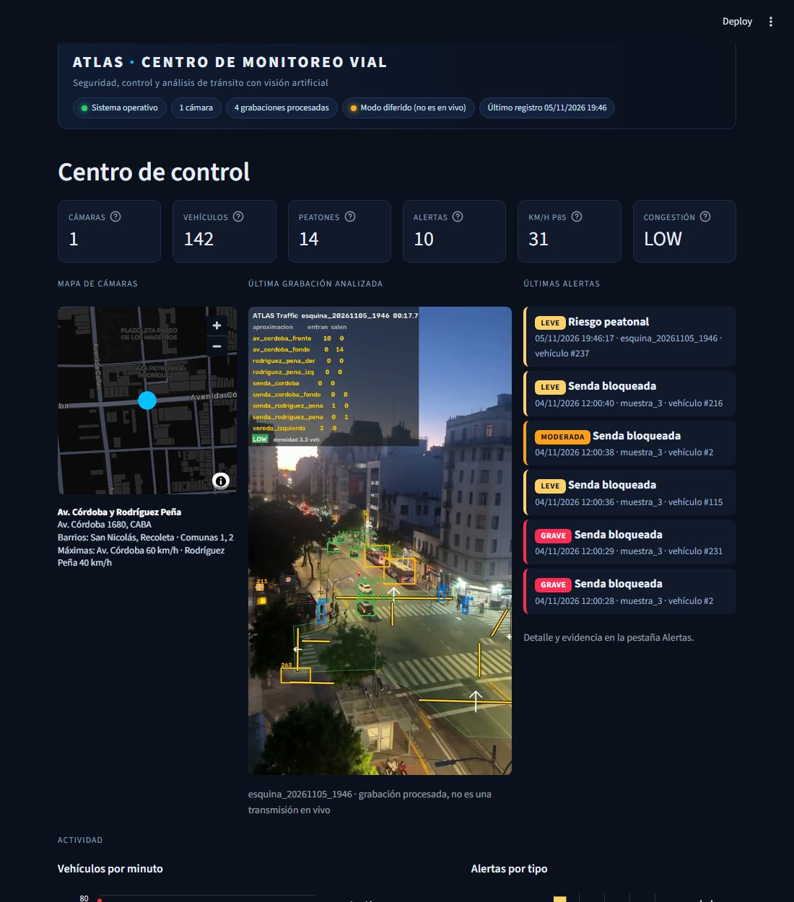
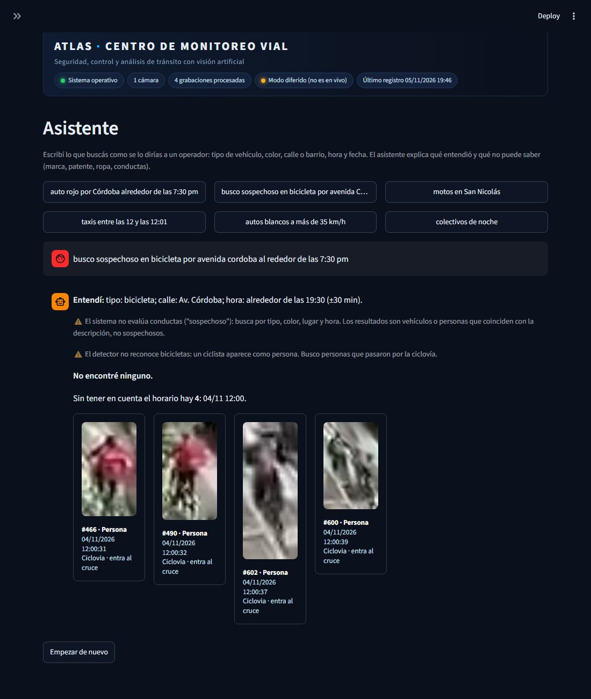
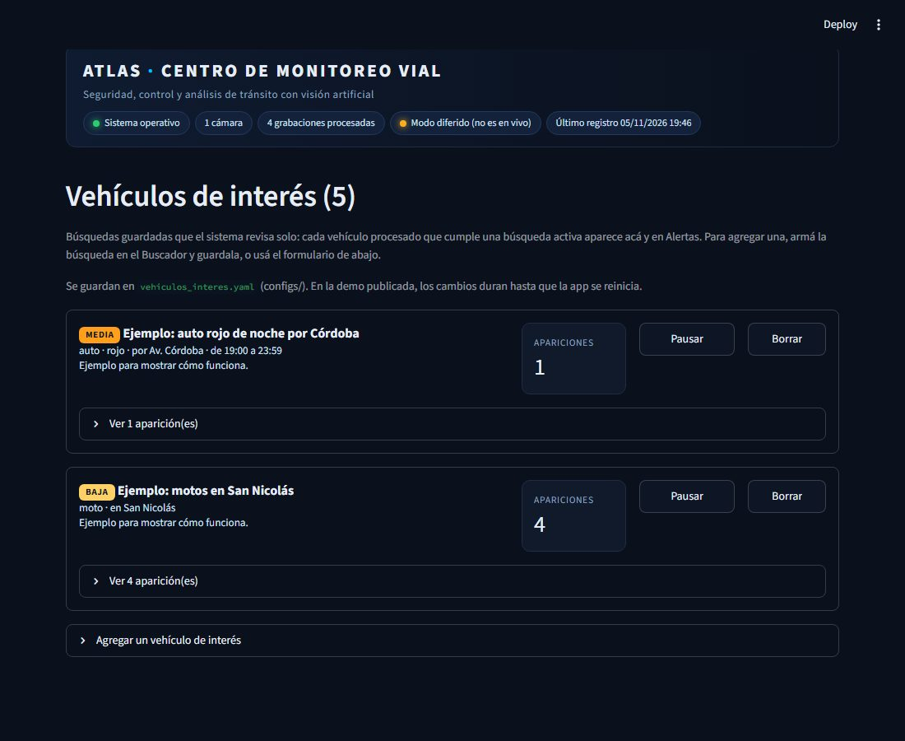
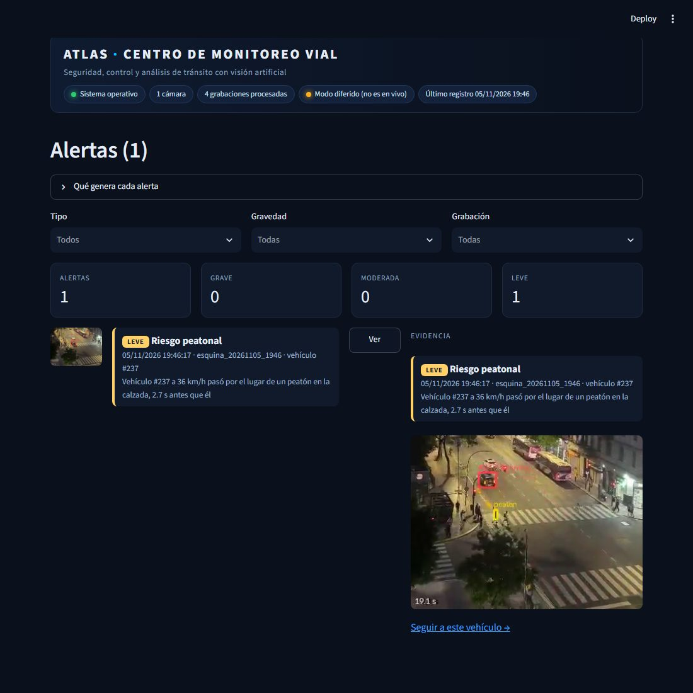
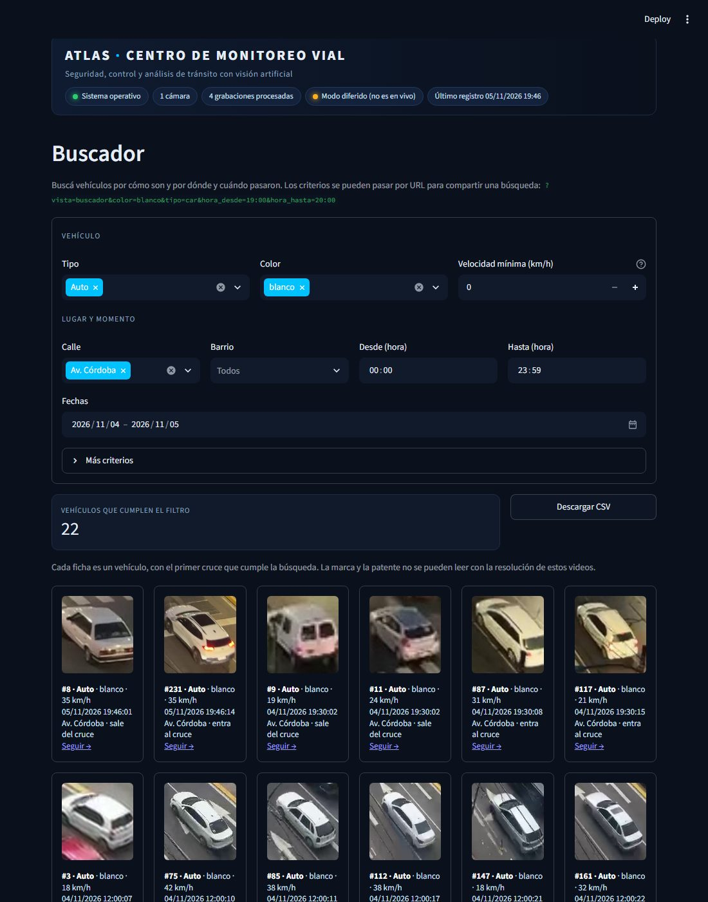
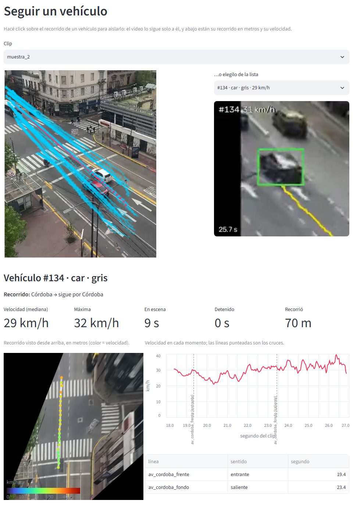
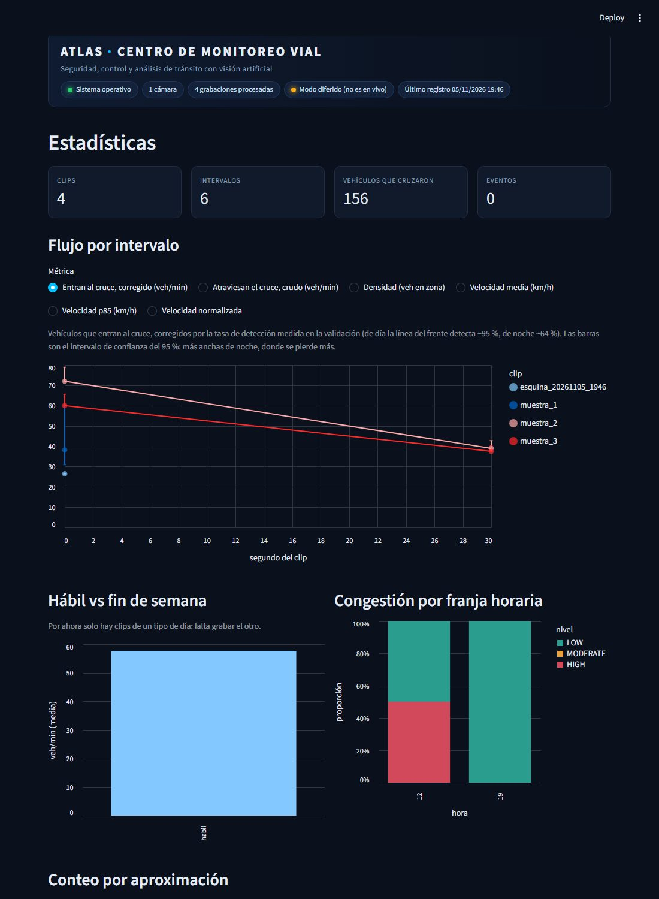

# ATLAS Traffic

[](https://github.com/licgermancardenas-crypto/ATLAS-TRAFFIC/actions/workflows/ci.yml)


Pipeline de visión por computadora que analiza el tránsito de una bocacalle filmada desde
un balcón (Av. Córdoba y Rodríguez Peña, CABA):
- cuenta vehículos **una sola vez y por aproximación**;
- clasifica la **congestión por densidad + velocidad**;
- detecta **circulación en sentido contrario**, **riesgo peatonal**, **sendas
  bloqueadas**, **detenciones prolongadas** y **exceso de velocidad**, con foto y video de
  evidencia;
- consolida varios clips en un dataset que se puede consultar vehículo por vehículo;
- lo muestra todo en un **centro de monitoreo** con buscador de vehículos.

<p align="center">
  
  &nbsp;
  
</p>

## Qué lo diferencia

Detectar autos lo hace cualquier tutorial. Esto resuelve cuatro cosas más:

1. **Conteo único, direccional y por aproximación.** Cada brazo del cruce tiene su línea
   virtual con sentido. El flujo se reporta por movimiento ("entran por Córdoba", "salen por
   el fondo") y no como un total.
2. **Congestión = densidad + velocidad, no volumen.** Mucho flujo rápido es tránsito fluido;
   mucha densidad lenta es congestión. Los umbrales salen de los propios datos
   (percentiles 33 y 66), no de números inventados.
3. **Comparabilidad entre clips.** Cada corrida alimenta un dataset con la fecha, el horario
   y el tipo de día de cada clip.
4. **Atributos consultables por vehículo.** Tipo, color, movimiento, momento del cruce y
   recorte de evidencia: "autos blancos que entraron por Córdoba entre los segundos 10 y 30"
   se responde en tres clics y se verifica mirando los recortes.

Además:
- **Usa un detector ajustado a esta esquina.** Es `yolov8s` reentrenado con imágenes de
  la propia esquina (fine-tuning): detecta el 88 % de los vehículos contra el 81 % del
  modelo general, y además motos. Ver [docs/entrenamiento.md](docs/entrenamiento.md).
- **Mide la velocidad en km/h.** La escala en metros sale de las franjas de las sendas
  peatonales, que tienen medida normalizada. Ver [docs/velocidad.md](docs/velocidad.md).
- **Detecta situaciones de riesgo peatonal:** un vehículo que pasa a menos de 2 m del
  lugar de un peatón en la calzada, con menos de 3 s de diferencia (PET, el indicador
  estándar de seguridad vial). Ver [docs/conflictos.md](docs/conflictos.md).
- **Detecta vehículos detenidos sobre la senda peatonal** (con su duración y si había
  personas cruzando) y detenciones prolongadas en la calzada mientras el tránsito sigue
  (posible doble fila). Ver [docs/infracciones.md](docs/infracciones.md).
- **Arma la matriz de giros:** por dónde entra y por dónde sale cada vehículo, con el
  porcentaje de cada giro y su margen de error. Ver [docs/giros.md](docs/giros.md).
- **Une los seguimientos cortados.** Cuando algo tapa un objeto un instante, o una
  persona se pierde en un grupo al cruzar una línea, los dos pedazos se unen para que
  el cruce cuente (`src/atlas_traffic/stitching.py`).
- **Compensa el movimiento de la cámara.** Los clips están filmados con el teléfono en
la mano y la vista se corre hasta 130 px. Cada frame se alinea con uno de referencia por
homografía, y el conteo trabaja en esas coordenadas fijas.

## Dashboard: centro de monitoreo vial



Tema oscuro de sala de control, con el estado del sistema arriba. Es un análisis de
grabaciones ya procesadas, no una transmisión en vivo, y lo dice en pantalla.

- **Centro de control:**
  - indicadores: cámaras, vehículos, peatones, alertas, velocidad p85 y congestión;
  - mapa con la ubicación de la cámara, sus barrios y las velocidades máximas;
  - la última grabación analizada y las últimas alertas;
  - actividad en el tiempo.
- **Alertas:** riesgo peatonal, senda bloqueada, detención prolongada, sentido contrario,
  exceso de velocidad y vehículos de interés en una sola lista,
  con gravedad (grave, moderada, leve) y filtros. Cada alerta tiene su evidencia en foto y
  video, y un link para seguir a ese vehículo.
- **Asistente:** búsqueda escrita como en un chat, por ejemplo "auto rojo por Córdoba
  alrededor de las 7:30 pm" o "busco sospechoso en bicicleta por avenida Córdoba".
  - **Qué entiende:** tipo, color, calle, barrio, hora ("7:30 pm", "entre las 19 y las
    20", "de noche"), fecha y velocidad.
  - **Qué responde:** qué entendió, los resultados y, si no hay ninguno, lo más parecido
    sin el horario.
  - **Qué aclara:** lo que no puede saber (marca, patente, ropa, conductas), y que las
    bicicletas se buscan como personas en la ciclovía, porque el detector no las
    reconoce.
  - **Cómo funciona:** es un intérprete de reglas (`src/atlas_traffic/lenguaje.py`), sin
    servicios externos ni costo. Cada búsqueda se puede guardar como vehículo de interés.

  
- **Buscador:** encuentra vehículos por:
  - tipo, color y velocidad mínima;
  - calle, barrio, rango de horas del día y fechas;
  - grabación, línea y sentido, y confianza del color.

  Cada resultado es una ficha con foto, hora exacta, calle y sentido, y un link para
  seguirlo. Las búsquedas se comparten por URL, por ejemplo
  `?vista=buscador&tipo=car&color=blanco&calle=av_cordoba&hora_desde=19:00&hora_hasta=20:00`.
  La marca y la patente no se pueden leer con la resolución de estos videos.
- **Vehículos de interés:** búsquedas guardadas que el sistema revisa solo. Cada
  vehículo que cumple una búsqueda activa aparece en la lista y genera una alerta con la
  prioridad elegida (alta, media o baja).
  - Se crean desde el Buscador ("Guardar esta búsqueda") o con un formulario.
  - Cada búsqueda se puede pausar o borrar.
  - Se guardan en `configs/vehiculos_interes.yaml`, que también se puede editar a mano.
  - Al terminar `atlas-traffic batch` se listan las apariciones; también con
    `atlas-traffic interes`.

  
- **Seguir un vehículo:** se hace click sobre el recorrido de un vehículo en la imagen de
  la esquina (o se lo elige de una lista) y se analiza solo ese vehículo:
  - un video con una cámara virtual que lo sigue, con zoom automático, su estela y su
    velocidad en cada momento;
  - su recorrido visto desde arriba, en metros, coloreado por velocidad;
  - su velocidad en el tiempo, con los cruces de línea marcados;
  - una ficha con tipo, color, recorte, por dónde entró y salió, velocidad mediana y
    máxima, tiempo en escena, tiempo detenido y distancia recorrida.

  Se comparte por URL: `?vista=seguir&clip=muestra_2&vehiculo=134`.
- **Cámaras:** el video procesado de cada grabación, con cajas, líneas, contadores y
  congestión en pantalla, y una leyenda.
- **Estadísticas:**
  - flujo, densidad y velocidad por intervalo;
  - velocidades por vehículo y matriz de giros;
  - conteo por aproximación con margen de error;
  - tabla de grabaciones.

| Alertas con evidencia | Buscador |
|---|---|
|  |  |

| Seguir un vehículo | Estadísticas |
|---|---|
|  |  |

La ubicación de cada cámara está en `configs/camaras.yaml`: dirección, barrios, comunas,
coordenadas y velocidad máxima de cada calle. La ubicación y los barrios se verificaron con
el normalizador de direcciones del GCBA (USIG). Av. Córdoba es el límite entre San Nicolás
y Recoleta, así que la esquina aparece en los dos barrios.

**Online:** https://atlas-traffic.streamlit.app — el dashboard se publica en Streamlit
Community Cloud desde este repo
(`dashboard/app.py`, dependencias en `dashboard/requirements.txt`). Muestra los datos de
`demo/outputs/`, que se actualizan con `python scripts/publicar_demo.py` después de
`atlas-traffic batch`. Al subir a `main`, la app se actualiza sola.

## Instalación

```bash
git clone https://github.com/licgermancardenas-crypto/ATLAS-TRAFFIC atlas-traffic
cd atlas-traffic
uv venv --python 3.11
uv pip install -e ".[detect,dashboard,dev]"
```

| Extra | Contiene |
|---|---|
| `detect` | YOLO + ByteTrack (Ultralytics, AGPL-3.0) |
| `dashboard` | Streamlit + Altair |
| `dev` | pytest + ruff |

El núcleo y los tests no necesitan `detect`.

**Con Docker:**

```bash
docker build -t atlas-traffic .
docker run --rm -v "$PWD/data:/app/data" -v "$PWD/outputs:/app/outputs" -v "$PWD/configs:/app/configs" atlas-traffic batch --render
docker run --rm -p 8501:8501 -v "$PWD/outputs:/app/outputs" -v "$PWD/configs:/app/configs" atlas-traffic dashboard
```

## Uso

```bash
# 1. Registrar el clip en configs/clips.yaml y copiar el video a data/raw/
# 2. Marcar la zona de análisis y las líneas de conteo (una vez por encuadre)
atlas-traffic geometry --clip muestra_2         # editor con el mouse
atlas-traffic geometry --clip muestra_2 --ver   # dibuja lo guardado a PNG

# 3. Procesar todo el dataset de punta a punta
atlas-traffic batch --render

# 4. Explorar
atlas-traffic dashboard
```

**Otros comandos:**

| Comando | Qué hace |
|---|---|
| `atlas-traffic run --clip <id> [--render] [--debug-video]` | procesa un clip |
| `atlas-traffic run --clip <id> --reusar-detecciones` | recuenta en segundos, sin volver a correr YOLO (útil al corregir la geometría) |
| `atlas-traffic calibrate` | recalcula los umbrales de congestión |
| `... --modelo yolov8s.pt` | usa el YOLO general en vez del modelo ajustado a la esquina |

## Cómo funciona

```
video ─► Detector (protocolo) ─► tracks con ID ─► estabilización (homografía a un frame de referencia)
                                                          │
          ┌──────────────────┬───────────────────┬────────┴─────────┬──────────────────┐
          ▼                  ▼                   ▼                  ▼                  ▼
   conteo por línea   métricas por 30 s     color por voto    sentido contrario   recortes
   (cruce + sentido)  (flujo, densidad,     (HSV relativo     (3 filtros anti-    de evidencia
                       velocidad)            al asfalto)        falso positivo)
          └──────────────────┴─────────┬─────────┴──────────────────┘
                                       ▼
                 congestión (velocidad normalizada por encuadre, cortes p33/p66, matriz)
                                       ▼
                      summary / tracks / cruces / eventos ─► dashboard
```

| Módulo | Responsabilidad |
|---|---|
| `detect.py` | Protocolo `Detector` + `UltralyticsDetector` + `FakeDetector` para tests. El vocabulario COCO no sale del adaptador. |
| `stabilize.py` | Homografía por frame (ORB + RANSAC, sin las cajas de vehículos), suavizada en el tiempo. |
| `geometry.py` | Zona de análisis, líneas, zonas de exclusión y convención de lado; editor interactivo. |
| `counting.py` | Cruce con banda muerta, corte real del segmento, conteo único por línea y sentido. |
| `metrics.py` | Flujo, densidad y velocidad por ventana; velocidad por desplazamiento en ventana (robusta al temblor). |
| `attributes.py` | Color por votación y recortes. |
| `alerts.py` | Regla de sentido contrario. |
| `congestion.py` | Calibración y matriz de congestión. |
| `correction.py` | Conteos corregidos por tasa de detección, con intervalo de confianza; detección día / noche. |
| `aggregate.py` | Consolidación multi-clip. |
| `consulta.py` | Lógica del dashboard. |
| `render.py` | Video anotado y GIF. |

**Salidas por clip** (`outputs/runs/<clip>/`):
- `detecciones.parquet`, `tracks.parquet`, `cruces.parquet`, `intervalos.parquet`, `eventos.parquet`;
- `thumbs/` y `eventos/` (recortes);
- `anotado.mp4` y `muestra.gif`.

**Consolidados** (`outputs/`): `summary.parquet`, `tracks_todos.parquet`,
`cruces_todos.parquet`, `eventos_todos.parquet`.

**Configuración:**
- `configs/default.yaml`: parámetros, todos validados con Pydantic.
- `configs/clips.yaml`: registro de clips.
- `configs/geometria/*.yaml`: una geometría por encuadre (zona de análisis, líneas y
  zonas de exclusión).
- `configs/calibracion.yaml`: umbrales de congestión, versionados para auditarlos.

## Resultados y validación

Cada criterio de aceptación del brief se midió y está documentado, incluso cuando no se
cumplió del todo.

| Fase | Criterio | Resultado | Detalle |
|---|---|---|---|
| Conteo | ±10 % por línea contra conteo manual | ✅ muestra_2: −4.5 %, −5.6 % y 0 %. ⚠️ muestra_3: frente ✅, fondo ✗ (motos). ❌ noche. Cero cruces falsos en los tres clips | [validacion_conteo.md](docs/validacion_conteo.md) |
| Personas | (fuera del brief) | ⚠️ vereda 4 de 7, ciclovía ~4 de 9. Sin conteos falsos | [validacion_peatones.md](docs/validacion_peatones.md) |
| Velocidad | (fuera del brief) | ✅ fluido 27–32 km/h de mediana, cola 6 km/h; dos métodos coinciden a ±1,4 km/h; margen ±5 % | [velocidad.md](docs/velocidad.md) |
| Video original | (fuera del brief) | ✅ iPhone sin WhatsApp: entrada de Córdoba 10/10, salida 15/15. ❌ un colectivo con luces interiores no se detecta | [validacion_video_original.md](docs/validacion_video_original.md) |
| Color | saturados > 85 %, acromáticos > 65 % | ✅ día 88 % y 76 %; noche 100 % y 71 % con balance de blancos | [validacion_color.md](docs/validacion_color.md) |
| Riesgo peatonal | (fuera del brief) | ⚠️ 8 candidatos revisados a ojo: 7 falsos (postes, reflejos, gente esperando en el cordón) descartados con filtros; queda 1 real (leve, PET 2,7 s) | [conflictos.md](docs/conflictos.md) |
| Senda bloqueada | (fuera del brief) | ✅ 8 alertas en la cola de muestra_3: 7 claras y 1 límite (el auto apenas toca el borde). Descartadas 6 sobre sendas no calibradas | [infracciones.md](docs/infracciones.md) |
| Detención prolongada | (fuera del brief) | ⚠️ 1 alerta (taxi 35 s junto al cordón). Es para revisar: el sistema no sabe dónde está el carril de estacionamiento | [infracciones.md](docs/infracciones.md) |
| Sentido contrario | cero falsos positivos | ✅ 0 eventos en 3 clips; la prueba controlada dispara en 81 de 84 cruces | [validacion_alertas.md](docs/validacion_alertas.md) |
| Congestión | congestionado = HIGH, liviano = LOW, sin ajuste manual | ✅ con la salvedad del supuesto de flujo libre | [validacion_congestion.md](docs/validacion_congestion.md) |
| Batch | un comando reprocesa todo | ✅ 3 clips en 577 s | — |
| Dashboard | la consulta del brief en tres clics, verificable con recortes | ✅ 9 vehículos, 9 recortes | captura de arriba |

**Cómo se validó:**
- **Conteo:** el conteo de referencia no usa el detector. Se armó un barrido temporal de
  los píxeles sobre cada línea (`scripts/barrido_temporal.py`) y se contó a ciegas.
- **Color:** los umbrales se eligieron con una muestra y se midieron una sola vez sobre
  otra, disjunta.
- **Quién etiquetó:** los conteos y las etiquetas de referencia los hizo Claude (Claude
  Code) mirando imágenes, no una persona. Conviene repetirlos a mano.

## Números con margen de error

Los conteos automáticos pierden vehículos, sobre todo motos lejanas y autos oscuros de
noche, pero no inventan: en la validación no hubo ni un cruce falso. Por eso cada conteo
se corrige con la **tasa de detección** medida contra los conteos manuales
(`docs/validacion_conteo_registros.csv`), por línea y por luz (día / noche), y se reporta
con **intervalo de confianza del 95 %** (Wilson).

| Clip | Entran al cruce (contados) | Corregido | Intervalo 95 % |
|---|---|---|---|
| muestra_2 (día), 0–30 s | 72 veh/min | 72 | 72–79 |
| muestra_1 (noche) | 27 veh/min | 38 | 31–60 |

- **La métrica principal es el flujo que entra al cruce.** Cada vehículo entra una sola
  vez, y la entrada de Córdoba es la línea más cercana a la cámara, donde los vehículos se
  ven grandes.
- **Cómo leer el margen:** es angosto de día, donde la línea del frente detecta el 100 %
  de los vehículos de la validación, y ancho de noche, donde detecta ~71 % con menos datos.
- **Qué queda afuera:** las líneas sin validar no se corrigen y quedan marcadas.
- **El día o la noche** se detecta solo, por el tinte naranja del alumbrado en la calle, o
  se declara con `luz:` en `clips.yaml`.
- **Salvedad:** en estos tres clips la corrección es parcialmente circular, porque las
  tasas se midieron sobre ellos mismos. Está pensada para los clips que se procesen
  después.

## Limitaciones

- **Videos de muestra:** pasaron por WhatsApp, que los bajó a 464 × 832 y les metió
  compresión. Fueron filmados con la cámara en mano y cada uno tiene un encuadre distinto.
  El sistema lo compensa, pero los resultados van a mejorar con video original y teléfono
  fijo en la baranda (brief §8).
- **Personas:**
  - Cada línea declara qué cuenta (vehículos o personas). Hay líneas de personas sobre
    las sendas peatonales, la vereda de Córdoba y la ciclovía (el modelo ve a los
    ciclistas como personas).
  - Contra un conteo manual, el sistema detecta ~57 % de la gente que camina por la
    vereda (4 de 7) y ~45 % de los ciclistas, siempre por omisión y sin conteos falsos.
    Son personas de ~25 px que caminan en grupo. Ver
    [docs/validacion_peatones.md](docs/validacion_peatones.md).
  - Nadie cruzó la calle por las sendas durante los clips: las personas cercanas esperan
    en la esquina mientras los autos tienen verde.
- **Motos:** el modelo ajustado a la esquina empieza a detectarlas (en el fondo de
  muestra_3 recupera 2 de 5), pero las lejanas se siguen perdiendo. Subir la resolución
  de inferencia no lo resuelve: con la compresión de WhatsApp esa información ya se perdió.
- **Noche:**
  - La detección degrada: el conteo da −36 % y −22 % en las líneas de Córdoba, siempre por
    omisión, sin cruces falsos.
  - La cámara se corre y saca del cuadro parte de las líneas.
  - La luz naranja del alumbrado hacía que los autos blancos salieran "amarillo". Un
    balance de blancos local, que toma el asfalto como gris de referencia, lo corrige y
    lleva los acromáticos nocturnos de 24 % a 71 % (medición optimista; ver el documento).
  - El clip nocturno queda acá y no en el demo principal.
- **Color acromático:** blanco, plata y gris se confunden según la luz, y un blanco en
  sombra mide gris. Los colores saturados son mucho más confiables.
- **Congestión:** normalizar la velocidad por encuadre supone que cada encuadre tiene algún
  momento de flujo libre. Con un clip por encuadre no se cumple: la cola de muestra_3 hace
  que su "flujo libre" sea lento, y la clasificación termina dependiendo sobre todo de la
  densidad. Con 5 intervalos, además, los umbrales son poco estables.
- **Objetos fijos confundidos con vehículos:** una valla metálica, una vidriera iluminada
  y el techo de una parada.
  - Se resuelven con **zonas de exclusión** marcadas en la geometría de cada encuadre,
    que descartan solo tracks de vehículos (no peatones).
  - Se verificó que no le sacan ningún cruce al conteo.
  - No se usa un filtro automático de "objetos quietos", porque se llevaría puestos a los
    autos detenidos en la cola, que son justo los que importan para la congestión.
- **Datos provisorios:** la fecha y la hora de los clips son estimadas, hasta tener las
  reales.

## Privacidad y alcance

- **Fuera de alcance, a propósito:** lectura de patentes, reconocimiento facial y
  seguimiento de personas entre cámaras. Cambiarían la categoría regulatoria del proyecto
  (Ley 25.326 de Protección de Datos Personales). El sistema trabaja con conteos agregados
  y eventos de tránsito.
- **Material público:** el GIF y las capturas del README tienen baja resolución (320 a
  380 px de ancho), así que no se pueden leer patentes ni distinguir caras.
- **Videos:** `data/raw/` está fuera del repositorio.

## Licencia

- **Código propio:** MIT.
- **Ultralytics (YOLO), extra `detect`:** AGPL-3.0. Para este proyecto abierto el uso es
  conforme. Si derivara en un producto cerrado, el detector está detrás de un protocolo
  (`atlas_traffic.detect.Detector`) y se puede cambiar por un motor Apache 2.0 (RF-DETR,
  RT-DETR, YOLOX) sin tocar el resto del pipeline.

Especificación completa del proyecto: [docs/ATLAS-Traffic-Brief.pdf](docs/ATLAS-Traffic-Brief.pdf).
