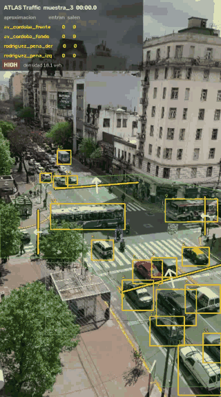
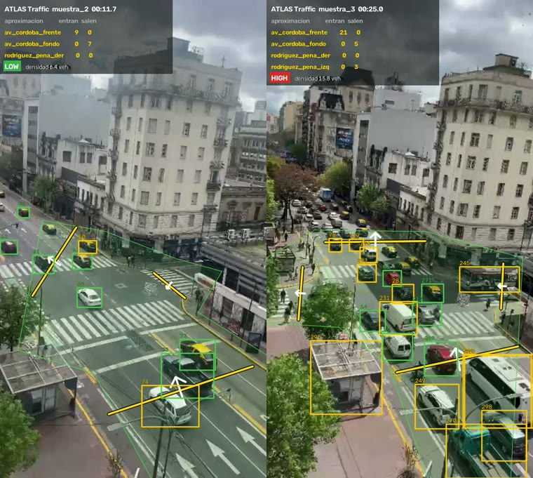
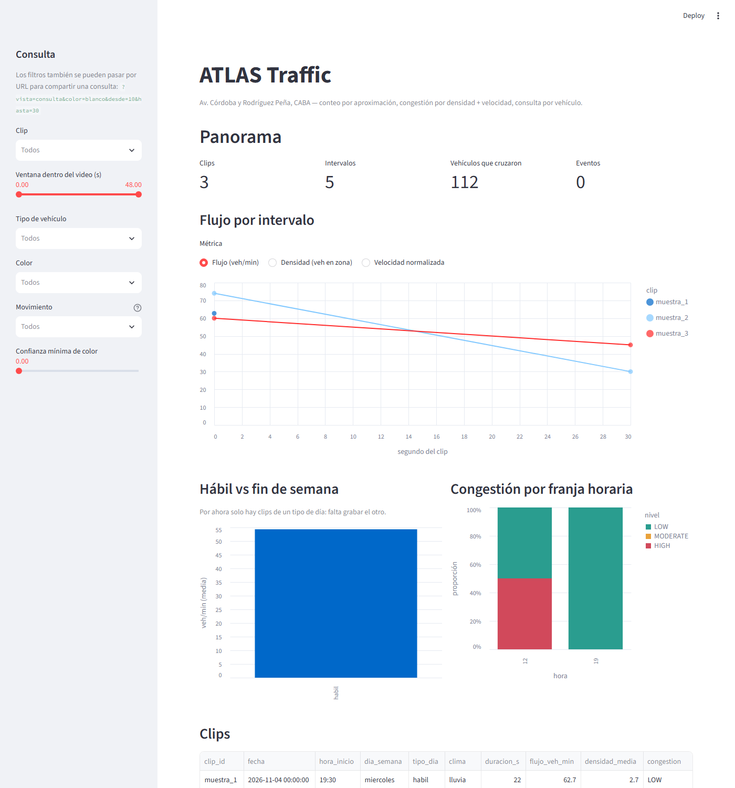
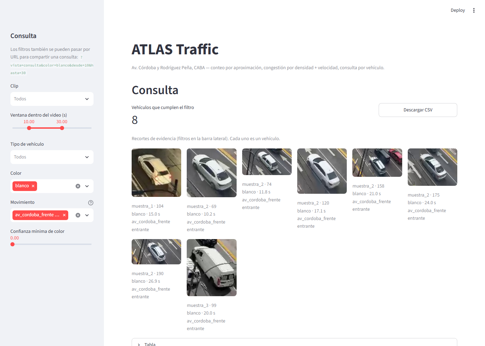

# ATLAS Traffic

[](https://github.com/licgermancardenas-crypto/ATLAS-TRAFFIC/actions/workflows/ci.yml)


Pipeline de visión por computadora que analiza el tránsito de una bocacalle filmada desde
un balcón (Av. Córdoba y Rodríguez Peña, CABA):
- cuenta vehículos **una sola vez y por aproximación**;
- clasifica la **congestión por densidad + velocidad**;
- detecta **circulación en sentido contrario**;
- consolida varios clips en un dataset que se puede consultar vehículo por vehículo.

<p align="center">
  
  &nbsp;
  
</p>

## Qué lo diferencia

Detectar autos lo hace cualquier tutorial. Esto resuelve cuatro cosas más:

1. **Conteo único, direccional y por aproximación.** Cada brazo del cruce tiene su línea
   virtual con sentido. El flujo se reporta por movimiento ("entran por Córdoba", "salen por
   el fondo") y no como un total.
2. **Congestión = densidad + velocidad, no volumen.** Mucho flujo rápido es tránsito fluido;
   mucha densidad lenta es congestión. Los umbrales salen de los propios datos
   (percentiles 33 y 66), no de números inventados.
3. **Comparabilidad entre clips.** Cada corrida alimenta un dataset con la fecha, el horario
   y el tipo de día de cada clip.
4. **Atributos consultables por vehículo.** Tipo, color, movimiento, momento del cruce y
   recorte de evidencia: "autos blancos que entraron por Córdoba entre los segundos 10 y 30"
   se responde en tres clics y se verifica mirando los recortes.

Además, **compensa el movimiento de la cámara.** Los clips están filmados con el teléfono en
la mano y la vista se corre hasta 130 px. Cada frame se alinea con uno de referencia por
homografía, y el conteo trabaja en esas coordenadas fijas.

## Dashboard

| Panorama | Consulta |
|---|---|
|  |  |

- **Panorama:** flujo, densidad y velocidad por intervalo; hábil contra fin de semana;
  congestión por franja horaria; tabla de clips.
- **Eventos:** cada alerta de sentido contrario con su recorte al lado.
- **Consulta:** filtros por clip, fechas, ventana dentro del video, tipo, color, movimiento
  y confianza de color. Muestra el conteo de vehículos únicos, la grilla de recortes y la
  descarga a CSV. Cualquier consulta se comparte por URL, por ejemplo
  `?vista=consulta&color=blanco&desde=10&hasta=30`.

## Instalación

```bash
git clone https://github.com/licgermancardenas-crypto/ATLAS-TRAFFIC atlas-traffic
cd atlas-traffic
uv venv --python 3.11
uv pip install -e ".[detect,dashboard,dev]"
```

| Extra | Contiene |
|---|---|
| `detect` | YOLO + ByteTrack (Ultralytics, AGPL-3.0) |
| `dashboard` | Streamlit + Altair |
| `dev` | pytest + ruff |

El núcleo y los tests no necesitan `detect`.

**Con Docker:**

```bash
docker build -t atlas-traffic .
docker run --rm -v "$PWD/data:/app/data" -v "$PWD/outputs:/app/outputs" -v "$PWD/configs:/app/configs" atlas-traffic batch --render
docker run --rm -p 8501:8501 -v "$PWD/outputs:/app/outputs" -v "$PWD/configs:/app/configs" atlas-traffic dashboard
```

## Uso

```bash
# 1. Registrar el clip en configs/clips.yaml y copiar el video a data/raw/
# 2. Marcar la zona de análisis y las líneas de conteo (una vez por encuadre)
atlas-traffic geometry --clip muestra_2         # editor con el mouse
atlas-traffic geometry --clip muestra_2 --ver   # dibuja lo guardado a PNG

# 3. Procesar todo el dataset de punta a punta
atlas-traffic batch --render

# 4. Explorar
atlas-traffic dashboard
```

**Otros comandos:**

| Comando | Qué hace |
|---|---|
| `atlas-traffic run --clip <id> [--render] [--debug-video]` | procesa un clip |
| `atlas-traffic run --clip <id> --reusar-detecciones` | recuenta en segundos, sin volver a correr YOLO (útil al corregir la geometría) |
| `atlas-traffic calibrate` | recalcula los umbrales de congestión |

## Cómo funciona

```
video ─► Detector (protocolo) ─► tracks con ID ─► estabilización (homografía a un frame de referencia)
                                                          │
          ┌──────────────────┬───────────────────┬────────┴─────────┬──────────────────┐
          ▼                  ▼                   ▼                  ▼                  ▼
   conteo por línea   métricas por 30 s     color por voto    sentido contrario   recortes
   (cruce + sentido)  (flujo, densidad,     (HSV relativo     (3 filtros anti-    de evidencia
                       velocidad)            al asfalto)        falso positivo)
          └──────────────────┴─────────┬─────────┴──────────────────┘
                                       ▼
                 congestión (velocidad normalizada por encuadre, cortes p33/p66, matriz)
                                       ▼
                      summary / tracks / cruces / eventos ─► dashboard
```

| Módulo | Responsabilidad |
|---|---|
| `detect.py` | Protocolo `Detector` + `UltralyticsDetector` + `FakeDetector` para tests. El vocabulario COCO no sale del adaptador. |
| `stabilize.py` | Homografía por frame (ORB + RANSAC, sin las cajas de vehículos), suavizada en el tiempo. |
| `geometry.py` | Zona de análisis, líneas y convención de lado; editor interactivo. |
| `counting.py` | Cruce con banda muerta, corte real del segmento, conteo único por línea y sentido. |
| `metrics.py` | Flujo, densidad y velocidad por ventana; velocidad por desplazamiento en ventana (robusta al temblor). |
| `attributes.py` | Color por votación y recortes. |
| `alerts.py` | Regla de sentido contrario. |
| `congestion.py` | Calibración y matriz de congestión. |
| `aggregate.py` | Consolidación multi-clip. |
| `consulta.py` | Lógica del dashboard. |
| `render.py` | Video anotado y GIF. |

**Salidas por clip** (`outputs/runs/<clip>/`):
- `detecciones.parquet`, `tracks.parquet`, `cruces.parquet`, `intervalos.parquet`, `eventos.parquet`;
- `thumbs/` y `eventos/` (recortes);
- `anotado.mp4` y `muestra.gif`.

**Consolidados** (`outputs/`): `summary.parquet`, `tracks_todos.parquet`,
`cruces_todos.parquet`, `eventos_todos.parquet`.

**Configuración:**
- `configs/default.yaml`: parámetros, todos validados con Pydantic.
- `configs/clips.yaml`: registro de clips.
- `configs/geometria/*.yaml`: una geometría por encuadre.
- `configs/calibracion.yaml`: umbrales de congestión, versionados para auditarlos.

## Resultados y validación

Cada criterio de aceptación del brief se midió y está documentado, incluso cuando no se
cumplió del todo.

| Fase | Criterio | Resultado | Detalle |
|---|---|---|---|
| Conteo | ±10 % por línea contra conteo manual | ✅ −9.1 %, −5.6 % y 0 %; cero cruces falsos | [validacion_conteo.md](docs/validacion_conteo.md) |
| Color | saturados > 85 %, acromáticos > 65 % | ⚠️ 82 % y 65 % (muestra de 28) | [validacion_color.md](docs/validacion_color.md) |
| Sentido contrario | cero falsos positivos | ✅ 0 eventos en 3 clips; la prueba controlada dispara en 81 de 84 cruces | [validacion_alertas.md](docs/validacion_alertas.md) |
| Congestión | congestionado = HIGH, liviano = LOW, sin ajuste manual | ✅ con la salvedad del supuesto de flujo libre | [validacion_congestion.md](docs/validacion_congestion.md) |
| Batch | un comando reprocesa todo | ✅ 3 clips en 577 s | — |
| Dashboard | la consulta del brief en tres clics, verificable con recortes | ✅ 8 vehículos, 8 recortes | captura de arriba |

**Cómo se validó:**
- **Conteo:** el conteo de referencia no usa el detector. Se armó un barrido temporal de
  los píxeles sobre cada línea (`scripts/barrido_temporal.py`) y se contó a ciegas.
- **Color:** los umbrales se eligieron con una muestra y se midieron una sola vez sobre
  otra, disjunta.
- **Quién etiquetó:** los conteos y las etiquetas de referencia los hizo Claude (Claude
  Code) mirando imágenes, no una persona. Conviene repetirlos a mano.

## Limitaciones

- **Videos de muestra:** pasaron por WhatsApp, que los bajó a 464 × 832 y les metió
  compresión. Fueron filmados con la cámara en mano y cada uno tiene un encuadre distinto.
  El sistema lo compensa, pero los resultados van a mejorar con video original y teléfono
  fijo en la baranda (brief §8).
- **Peatones:** a esta resolución miden unos 10 px y casi no se detectan; el flujo
  peatonal da 0 y no es real. Tampoco se detectan bien las motos, y se pierde algún auto en
  el borde inferior del cuadro.
- **Noche:**
  - La detección degrada (se pierden motos y autos oscuros).
  - El color no es confiable: la luz naranja del alumbrado hace que autos blancos salgan
    "amarillo" (solo ~4 de 12 "amarillos" nocturnos son taxis).
  - El clip nocturno queda acá y no en el demo principal.
- **Color acromático:** blanco, plata y gris se confunden según la luz, y un blanco en
  sombra mide gris. Los colores saturados son mucho más confiables.
- **Congestión:** normalizar la velocidad por encuadre supone que cada encuadre tiene algún
  momento de flujo libre. Con un clip por encuadre no se cumple: la cola de muestra_3 hace
  que su "flujo libre" sea lento, y la clasificación termina dependiendo sobre todo de la
  densidad. Con 5 intervalos, además, los umbrales son poco estables.
- **Falsos positivos estáticos:** el techo de una parada de colectivos se detecta como
  vehículo y puede sumar uno a la densidad.
- **Datos provisorios:**
  - Fecha y hora de los clips estimadas, hasta tener las reales.
  - Sentido de Rodríguez Peña deducido de pocas observaciones, pendiente de confirmar.

## Privacidad y alcance

- **Fuera de alcance, a propósito:** lectura de patentes, reconocimiento facial y
  seguimiento de personas entre cámaras. Cambiarían la categoría regulatoria del proyecto
  (Ley 25.326 de Protección de Datos Personales). El sistema trabaja con conteos agregados
  y eventos de tránsito.
- **Material público:** el GIF y las capturas del README tienen baja resolución (320 a
  380 px de ancho), así que no se pueden leer patentes ni distinguir caras.
- **Videos:** `data/raw/` está fuera del repositorio.

## Licencia

- **Código propio:** MIT.
- **Ultralytics (YOLO), extra `detect`:** AGPL-3.0. Para este proyecto abierto el uso es
  conforme. Si derivara en un producto cerrado, el detector está detrás de un protocolo
  (`atlas_traffic.detect.Detector`) y se puede cambiar por un motor Apache 2.0 (RF-DETR,
  RT-DETR, YOLOX) sin tocar el resto del pipeline.

Especificación completa del proyecto: [docs/ATLAS-Traffic-Brief.pdf](docs/ATLAS-Traffic-Brief.pdf).
